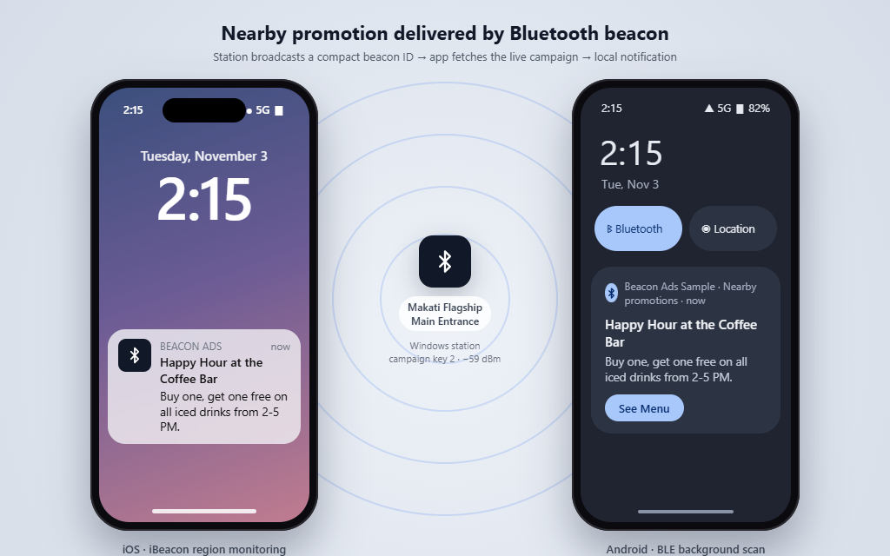

# Mobile sample apps

Minimal Android (Kotlin) and iOS (Swift/SwiftUI) apps that detect Beacon Ads stations, fetch the
active campaign from the mobile API and show it as a local notification. Tapping the notification
reports a click and opens the landing page.



*Illustrative mockup with the live "Coffee Bar Happy Hour" campaign content (source: `mockup/notification-mockup.html`).*

| | Android | iOS |
| --- | --- | --- |
| Detection | BLE scan with `PendingIntent` (works when the app is closed) | Core Location iBeacon region monitoring |
| Station format | BPA manufacturer data **or** iBeacon | **iBeacon only** (iOS hides other beacon data) |
| Source | `android/` (open in Android Studio) | `ios/` (Xcode on a Mac) |

Both apps send only a random per-install token, never MAC addresses or advertising IDs. Only
`notification_displayed` counts as an impression; events from the in-app test button are tagged
`appVersion = "sample-test"` and the test never reports a fake `beacon_detected`.

## Values you need

| Setting | Where to find it |
| --- | --- |
| Server URL | `http://<this PC's LAN IP>:3000` for development, e.g. `http://10.0.254.54:3000`. The phone must be on the same network. |
| Mobile API key | `MOBILE_API_KEY` in `apps/web/.env` |
| Station beacon UUID | Dashboard → Bluetooth Stations → station → *Beacon UUID* (copy button) |
| Company ID (Android) | System Settings company identifier; `FFFF` while using the development test ID |

If the phone cannot reach the server, allow the port in Windows Firewall (Administrator PowerShell):

```powershell
New-NetFirewallRule -DisplayName "Beacon Ads dev server" -Direction Inbound -Protocol TCP -LocalPort 3000 -Action Allow -Profile Private
```

## Quick demo without a Bluetooth station

Both apps have a **Fetch campaign and notify** button. Enter the station beacon UUID and tap it: the
app calls the real API exactly as it would after a detection and shows the real notification. This
works even though the station PC has no Bluetooth adapter.

## Android

1. Open `apps/mobile-samples/android` in Android Studio (Ladybug or newer). Let it sync and create the
   Gradle wrapper if prompted.
2. Run on a physical phone (emulators have no BLE), Android 8.0+.
3. In the app: enter server URL, API key and company ID → **Save settings**.
4. Tap **1. Grant …** and accept Bluetooth, location and notifications.
5. Tap **2. Allow scanning in the background** and choose *Allow all the time*. (Without it, beacons
   are detected only while the app is open.)
6. Tap **Start background scanning**. Near an advertising station, the notification appears within
   seconds to a minute (Android batches low-power background scans).

Logs: `adb logcat -s BeaconScanReceiver CampaignNotifier`.

## iOS

1. On a Mac with Xcode 15+: `brew install xcodegen`, then in `apps/mobile-samples/ios` run
   `xcodegen generate` and open `BeaconAdsSample.xcodeproj`. (Or create a new iOS App project named
   BeaconAdsSample and add the files from `BeaconAdsSample/`, using the provided `Info.plist`.)
2. Select your team under *Signing & Capabilities* and run on a physical iPhone (iOS 16+).
3. In the dashboard, set the station's **Advertisement format** to **iBeacon** (station page →
   Bluetooth configuration). The station beacon UUID becomes the iBeacon proximity UUID and the
   campaign key is sent as the minor.
4. In the app: server URL, API key and the station beacon UUID(s) → **Save settings**.
5. Tap **1. Allow notifications**, then **2. Allow location** twice (first *While Using*, then
   *Change to Always Allow*).
6. Tap **Start monitoring stations**. Entering a station's range wakes the app, which ranges briefly
   for the campaign key and RSSI, then shows the notification, even when the app is closed.

Region entry on iOS can take up to about a minute. iOS monitors at most 20 regions per app.

## Production notes

- Use `https://` and remove `usesCleartextTraffic` (Android) and `NSAllowsLocalNetworking` (iOS).
- Do not hard-code or log the API key in release builds. Treat it as an abuse deterrent, not a secret.
- Ship your own icons, channel names and privacy disclosures. Location permission text must explain
  the store-proximity use.
